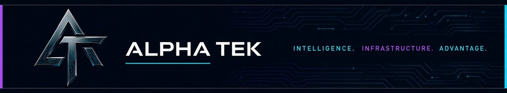
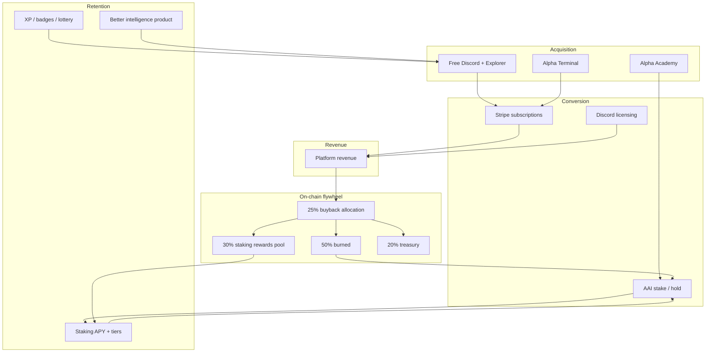

# AlphaAi (AAI) Token Whitepaper



**Version 2.1**  
**October 18, 2026**

**Official website:** [https://alphatek.app](https://alphatek.app)

*Devnet-verified protocol · Production intelligence platform · Institutional disclosure*

---

## Table of Contents

1. [Executive Summary](#executive-summary)
2. [Mission, Give-Back & Sustainability](#mission-give-back--sustainability)
3. [Introduction](#introduction)
4. [Problem Statement](#problem-statement)
5. [Solution: Alpha Tek Platform](#solution-alpha-tek-platform)
6. [The AlphaAi Token](#the-alphaai-token)
7. [Tokenomics](#tokenomics)
8. [Technical Architecture](#technical-architecture)
9. [Alpha Academy & Education](#alpha-academy--education)
10. [Community, Gamification & Retention](#community-gamification--retention)
11. [Use Cases & Utility](#use-cases--utility)
12. [Revenue Model](#revenue-model)
13. [Ecosystem Flywheel](#ecosystem-flywheel)
14. [Roadmap](#roadmap)
15. [Security & Transparency](#security--transparency)
16. [Verification Appendix](#verification-appendix)
17. [Risk Factors](#risk-factors)
18. [Conclusion](#conclusion)

---

## Executive Summary

**AlphaAi (AAI)** is a Solana SPL utility token that powers **Alpha Tek** — a production crypto intelligence stack spanning Discord command infrastructure, the **AlphaTek App** web platform ([alphatek.app](https://alphatek.app)), and four **Anchor programs** deployed and exercised on **Solana devnet**.

We built Epic Alpha to **give back**: free tools and resources so newcomers and working investors could access real intelligence without paying enterprise prices. Keeping everything free indefinitely was not sustainable. AAI and paid subscriptions exist so the mission can continue — free value at the base, premium depth for those who need it, and a **deflationary flywheel** that ties platform revenue to token utility.

### What is shipped (2025–2026)

| Layer | Status | Evidence |
|-------|--------|----------|
| **Discord Alpha Tek** | Production | 405+ commands, multi-chain monitoring, KOL/social/whale systems |
| **AlphaTek App** | Production | Explorer, Discover, Quant, KOL Radar, wallet, Stripe subscriptions, Privy auth |
| **Alpha Terminal** | Production | Hybrid coin pages (`/dashboard/coin/[id]`) with Blockchain.com on-chain metrics |
| **AAI Hub (devnet)** | Production UI + devnet chain | Stake / claim / unstake via Privy; activity feed; Devnet Ops health |
| **Anchor programs (devnet)** | Deployed, smoke-tested | Token, staking 0.6.0, buyback, referral — stable program IDs |
| **Alpha Academy** | Production | 42 interactive Mega Courses with quizzes, TTS, and certificate burns |
| **Gamification** | Production (V1) | XP ledger, badges, leaderboards, daily lottery scaffold |

### Key highlights

- **Working technology** — Not a roadmap token. Platform audit: 59+ API routes, 50+ backend services, real-time data pipelines (see `ALPHADEX_AUDIT_WHITEPAPER.md`).
- **Verifiable devnet activity** — 15 cataloged milestone transactions plus buyback split proof (**500 burn / 300 staking pool / 200 treasury** on 1,000 AAI test execute). See `docs/DEVNET_PUBLIC_BUILD_TX_TIMELINE_2026-05-25.md`.
- **Deflationary design** — 25% of platform revenue allocated to buybacks; on-chain **50% burn / 30% staking rewards / 20% treasury** enforced by `aai-buyback` basis points.
- **Staking with real APY tiers** — 15–30% APY by stake size (1K / 5K / 25K / 100K AAI), multi-position v2 on devnet.
- **Security discipline** — Internal self-audit completed 2026-05-27; P0 program fixes and adversarial negative tests in repo. **Independent third-party audit required before mainnet.**

### Honest scope boundary

**AAI on-chain programs are devnet-only today.** Mainnet program IDs in `aai-token/Anchor.toml` remain placeholders until audit and launch gates are cleared. This document distinguishes **what you can click on Solscan devnet** from **what remains pre-mainnet**.

---

## Mission, Give-Back & Sustainability

### Origin

Alpha Tek began inside **Epic Alpha Discord** as a give-back project: comprehensive crypto intelligence — whale alerts, KOL tracking, momentum tools, discovery — offered free so people who had lost money or had little to start with could make **informed** decisions instead of gambling on noise.

### The sustainability pivot

Free-only operations consumed founder time and infrastructure cost without return. To keep building for the Pack, Alpha Tek must become **self-sustaining** across three revenue rails:

1. **Subscription layer** · Stripe plans (Degen / Alpha / Elite), Discord bot licensing, and premium AlphaTek App modules fund development and infra.
2. **Token layer** · AAI stakes unlock tiers, rewards long-term holders, and receives **25% of revenue-driven buybacks** (50% burned, 30% to stakers, 20% treasury).
3. **Extension layer** · Alpha Trench Instant Trade, paper practice, and portal distribution put Alpha Tek on the venues traders already use · another growth and retention rail for the ecosystem.

This is not hype. It is the minimum viable economics to keep serving newcomers while shipping institutional-grade tooling.

---

## Introduction

Cryptocurrency markets generate more data than any individual can process. Intelligence is fragmented across dashboards, bots, APIs, and social feeds — often at $100–500/month per tool.

**Alpha Tek** unifies that stack: Discord for power users and alerts, **AlphaTek App** for visual discovery and portfolio workflows, and **AAI** for on-chain utility that aligns user growth with token value.

---

## Problem Statement

### The intelligence gap

1. **Fragmented sources** — Traders juggle five to ten tools with inconsistent formats.
2. **Cost barriers** — Premium data and social APIs price out retail participants.
3. **Technical complexity** — Raw APIs do not produce actionable alpha.
4. **Delayed signals** — Manual workflows miss fast-moving opportunities.
5. **Single-chain blind spots** — Most tools optimize for one chain; cross-chain context is rare.

### The opportunity

Demand for actionable crypto intelligence continues to grow across retail, creators, and institutions. Alpha Tek addresses this with **one platform footprint** and **accessible pricing**, backed by years of Discord-side iteration and a production web stack.

---

## Solution: Alpha Tek Platform

### Dual delivery model

| Surface | Role |
|---------|------|
| **Discord (Epic Alpha)** | Real-time commands, alerts, KOL/social/whale monitoring, admin tooling |
| **AlphaTek App (alphatek.app)** | Explorer, Discover, Quant social trading, wallet view, subscriptions, AAI Hub |

Both share backend services, caching, and data providers. Sensitive keys stay server-side; clients use JWT-authenticated APIs only.

### Core capabilities

#### Multi-chain intelligence

- **15 chains** monitored: Solana, Ethereum, Base, BSC, Robinhood, Polygon, Arbitrum, Optimism, Avalanche, Linea, Pulsechain, Fantom, Ronin, Sei, and Monad, via Alpha Tek partners and data providers.
- Unified chain selector across DEX Tracker and wallet explorer.
- Cross-chain trending, gainers, narratives, and search.

#### Token & wallet intelligence

- Trending and discovery feeds (MEXC Tide, DexScreener integrations, Pump.fun lifecycle).
- Wallet portfolios, swap history, PnL enrichment where providers support the chain.
- Whale and KOL tracking pipelines (Alpha Spy, KOL Scan integrations).

#### Alpha Terminal (2026)

**Alpha Terminal** extends coin pages for catalog large-cap assets with Blockchain.com-native metrics:

- Routes: `/dashboard/coin/[id]` (CoinGecko IDs such as `bitcoin`, `ethereum`, `solana`).
- Hybrid UI: price sidebar, sparklines (BTC), block explorers, mempool (BTC/ETH), metric catalog.
- **BUILD_ID auto-resolve** — backend scrapes Blockchain.com deploy IDs so `_next/data` panels survive upstream redeploys without manual env edits.
- Deep links from Discover and Crypto Bubbles ("Open Alpha Terminal").

See `docs/ALPHA_TERMINAL_TESTING_GUIDE_2026-05-25.md` for acceptance checklist.

#### Agents & automation

- Discord-side momentum/scalping analysis, CheckDex trending, Hyperliquid and DEX agent services (see `src/services/`).
- Platform-side quant feed, watchlist scanning (roadmap: full auto-scan persistence).

### Production tech stack

| Layer | Technology |
|-------|------------|
| Frontend | Next.js 16 (App Router), React 19, TypeScript, Tailwind |
| Backend | Node.js 20+, Express, PostgreSQL |
| Auth | JWT, Privy (Solana wallets), Stripe billing |
| Data | Moralis, Cielo, Blockchain.com proxy layer, cached TTL services |
| Real-time | SSE, WebSockets, webhooks, 2s–5s polling where appropriate |
| Chain programs | Anchor 0.32.x, Solana SPL |

**Platform scale (Feb 2026 audit):** 59+ routes, 50+ services, 29 API route modules — documented in `ALPHADEX_AUDIT_WHITEPAPER.md`.

**Discord scale:** 405+ commands, 65+ services in the bot stack — see beta testing guide.

**Replication cost:** Multi-month full-time engineering, six-figure API spend at scale, and continuous chain integration — a meaningful barrier to shallow forks.

---

## The AlphaAi Token

### Overview

**AlphaAi (AAI)** is the economic layer of Alpha Tek: platform credits, access tiers, staking rewards, referral incentives, and (roadmap) governance. It is a **utility token**, not a promise of passive investment returns.

### Specifications

| Field | Value |
|-------|-------|
| Name | AlphaAi |
| Symbol | AAI |
| Chain | Solana |
| Standard | SPL Token (9 decimals) |
| Total supply (design) | 1,000,000,000 AAI |
| **Devnet SPL mint** | `BKrLcYPybqAk2X1XugJJApMLD44asY9L3qgSqSJh5gYP` (10,000 UI test supply) |
| **Mainnet mint** | *Not deployed — set at mainnet launch* |
| Token program (devnet) | `SfozsQUG9qTPw2etjQ8P72oBpMdteN11AGX6rhfcRJB` |

### Three tier vocabularies (do not conflate)

Alpha Tek uses **three** tier systems. Each serves a different purpose:

| System | Names | Thresholds | Enforced where |
|--------|-------|------------|----------------|
| **Platform access** | Staker / Holder / Whale (+ Elite via Stripe) | **1,000 / 5,000 / 50,000 AAI wallet balance** | Platform `useAaiTier.ts`, feature gates |
| **On-chain staking** | Tier1–4 (Basic / Premium / Elite / Whale) | **1,000 / 5,000 / 25,000 / 100,000 AAI staked** | `aai-staking` program |
| **Referral ladder** | Bronze / Silver / Gold / Platinum | **1–5 / 6–20 / 21–50 / 51+ paid referrals** | `aai-referral` + backend commission |

**APY (staking program only):**

| Staked AAI | APY | Marketing label |
|------------|-----|-----------------|
| 1,000+ | 15% | Basic |
| 5,000+ | 20% | Premium |
| 25,000+ | 25% | Elite |
| 100,000+ | 30% | Whale |

Lock periods: **30 / 90 / 180 / 365 days** with multiplier bonuses. Rewards accrue on-chain; users **claim manually** (no auto-compound instruction today). Early unstake applies a linear penalty curve (patched 2026-05-25).

### Core utilities

#### Platform credits & energy

- AI analysis, agent calls, and premium modules consume credits or AAI (gating registry + Stripe tier resolution shipped).
- Design doc: pay-per-use **50/30/20 spend split** mirroring buybacks (`docs/AAI_SPEND_DISTRIBUTION_DESIGN.md`).

#### Access tiers (wallet balance)

- **Staker (1,000 AAI)** — Enhanced alerts, academy quotas, hub features.
- **Holder (5,000 AAI)** — Premium dashboard modules, referral tools.
- **Whale (50,000+ AAI)** — Enterprise-style gates, API-oriented surfaces.
- **Elite** — Stripe Enterprise subscription tier (not wallet-derived).

#### Staking (on-chain)

- **Multi-stake v2:** multiple independent positions per wallet (`initialize_stake_v2`, `claim_rewards_v2`, `unstake_v2`).
- Platform flow: prepare → Privy sign → confirm → activity/history indexing.
- Rewards paid from **`staking_rewards_pool` PDA** — same pool receiving buyback 30% allocation (D5 reconciliation complete).

#### Referral system

- On-chain referral accounts and paid-referral registration (authority-gated).
- Commission percentages (5% / 7% / 10% / 15%) enforced in **backend** today; tier thresholds tracked on-chain.
- One-time referral bonuses described in v1 whitepaper remain **off-chain ops** items.

#### Governance

- **Not implemented on-chain or in product UI.** Planned post-mainnet with clear holder communication.

---

## Tokenomics

### Supply distribution (design target)

| Allocation | Amount | % | Vesting |
|------------|--------|---|---------|
| Public sale | 300,000,000 | 30% | At launch (TBD) |
| Development | 200,000,000 | 20% | 4-year linear |
| Rewards pool | 250,000,000 | 25% | Over 4 years |
| Treasury | 150,000,000 | 15% | 2-year linear |
| Liquidity | 100,000,000 | 10% | At launch, locked |
| **Total** | **1,000,000,000** | **100%** | |

**Important:** Vesting schedules and the 1B cap are **operational/policy targets**. The devnet mint authority can inflate supply until mint authority is revoked at mainnet. See Security section.

### Deflationary mechanisms

#### Buyback & burn (revenue-linked)

- **25% of subscription and licensing revenue** → allocated to buybacks (off-chain treasury decision on devnet; policy unchanged).
- On-chain split via `execute_buyback`:

| Destination | Share |
|-------------|-------|
| Burn | 50% |
| Staking rewards pool | 30% |
| Treasury PDA | 20% |

**Devnet proof:** `execute_buyback` with 1,000 AAI → 500 burned, 300 to staking pool, 200 to treasury — tx `2ttW5QGMAVd4LWTbkcTN2qd22yFur18aG4VavcQwxD5M94GPJwd8MXx3QeTrjX3uzB8LDLTkan2uWzmJzonVEscd` (devnet). Details in timeline doc.

#### Staking locks

Staked principal reduces circulating supply for the lock duration and aligns holders with platform growth.

#### Usage burns (optional extension)

Premium spends may burn AAI or apply the same 50/30/20 split to user-initiated transactions (design locked; academy certificate burns live today).

### Supply projections (modeling only)

| Year | Circulating (model) | Staked (model) | Burned (model) | Total supply (model) |
|------|---------------------|----------------|----------------|----------------------|
| 1 | 750M | 200M | 50M | 950M |
| 2 | 600M | 300M | 100M | 900M |
| 3 | 450M | 400M | 150M | 850M |

These figures are **illustrative**, not guarantees. Actual burns depend on revenue, price, and ops execution.

---

## Technical Architecture

### Smart contracts (Solana / Anchor)

All four programs target Anchor **0.32.1**. Devnet IDs are **upgrade-in-place** (not redeployed under new addresses during the 2026-05-25 reconciliation).

| Program | Devnet ID | Role |
|---------|-----------|------|
| `aai_token` | `SfozsQUG9qTPw2etjQ8P72oBpMdteN11AGX6rhfcRJB` | Mint, burn, transfer helpers |
| `aai_staking` | `MA9KY9s6KsWHFSZMM2dBSf1huLjNU42p7ySLs6MamK4` | Multi-stake v2, rewards, vaults |
| `aai_buyback` | `9VXMHyt3BvJ7JHUpK2fMVtjx4n4oGSAj6sJ63G83uDxs` | `execute_buyback`, stats, vaults |
| `aai_referral` | `DeATqugv24zBBmX9DYEjJjh6yeu99GD1etrbiRRnLZTa` | Referral accounts, paid registration |

**Mainnet:** All four mainnet entries in `Anchor.toml` are System Program placeholders until launch.

#### Key PDAs (devnet, canonical deploy)

| Account | Address |
|---------|---------|
| Staking vault | `5V1GjuTEfRSf57sE6SJgJvTQDzDcS8acRkoJEk3vwga9` |
| Staking rewards pool | `BqCqHqLqGLKUAHiZsfriTf1DSbHsZaw98BArUsyTaefK` |
| Buyback vault | `EgKACqDLnp9bUc7hAUPL9xvYZUbPUVAGPjbcJ4SfQTbw` |
| Buyback treasury | `AkZQHPGytr1QSA9t747KRtomkQkZH6E8fcLE53UgBUMo` |

#### `initialize_pools`

Staking **0.6.0** introduces `initialize_pools()` — one-shot bootstrap of `staking_vault` and `staking_rewards_pool` PDAs. Required before buyback 30% can reach the pool stakers claim from.

- Smoke PASS: tx `dZ41TsgJZk8U7gdpq4BjSCGomMWqoX8ZisuZPSNHiHooNgfF4e8Qcg3gFqS9TsX5iGiR8iwfxJV9Kj6wRyXt5jX` (devnet).
- Ops script: `aai-token/scripts/devnet-smoke-init.ts` (`--init` when vaults missing).

#### Devnet smoke coverage (operator-run)

| Test | Section | Status |
|------|---------|--------|
| Pool bootstrap | §9.1 | PASS |
| Buyback 50/30/20 | §9.2 | PASS |
| Legacy claim/unstake | §9.3 | SKIP OK on greenfield devnet (no v1 cohort) |
| Multi-stake v2 | §9.4 | PASS |
| Referral authority | §9.5 | PASS (2026-05-27) |

Runbook: `docs/DEVNET_REDEPLOY_RUNBOOK_2026-05-25.md`.

### Platform integration

| Component | Purpose |
|-----------|---------|
| `aaiStakingService.js` | Prepare / confirm stake, claim, unstake |
| `solanaAaiService.js` | PDA helpers, instruction builders, balance reads |
| `devnetAaiHealthService.js` | Admin Devnet Ops parity banner |
| `aaiBuybackExecutorService.js` | Authority-gated buyback execution |
| `aaiStakeEventsBackfillWorker.js` | Chain → Postgres activity parity |
| `blockchainPricesService.js` | Alpha Terminal price + BUILD_ID resolve |
| Stripe + `featureGateService.js` | Subscriptions × AAI tier resolution |

**AAI Hub (production):** `/dashboard/aai` — wallet connect (Privy), stake positions, activity feed, lottery, leaderboards, earnings.

**E2E checklist:** `docs/DEVNET_E2E_HUB_WALKTHROUGH_2026-05-26.md`.

---

## Alpha Academy & Education

**Alpha Academy** is the platform education layer — free and gated content that turns intelligence features into structured learning.

### Mega Courses (shipped)

- **42 interactive Mega Courses** in `platform/backend/data/academy-quiz-courses/` (e.g., Crypto 101, Rug Checks, DEX Tracker Deep Dive, Macro 101, Polymarket guides, Alpha Tek overview).
- Format: multi-section readings, inline quizzes, pass thresholds (typically 60%+), optional speed/share bonuses.
- **Listen Mode (TTS)** with AAI-tier daily minute quotas.
- **On-chain certificates:** course completion can trigger SPL **burn** transactions via `academyCertificateService` (prepare → sign → confirm pattern reused for future AAI spend flows).
- **Leaderboards:** per-course and aggregate academy rankings.
- **Gating:** Mega Course full access tied to feature gate registry (stake / subscribe / spend unlocks per `FEATURE_GATE_OPERATIONS.md`).

Academy progress feeds the **XP system** when a wallet is linked (see below).

---

## Community, Gamification & Retention

Gamification rewards **learning and engagement**, not wash trading. Systems shipped or scaffolded in 2025–2026:

### XP & activity ranking

- Unified XP ledger (`aai_user_xp`, `aai_user_xp_events`) with deduped event types: login streaks, academy completions, staking actions, quant activity, tips, badges.
- Public leaderboards at `/dashboard/aai/leaderboards` with daily caps and diminishing returns to limit farming.
- Design: `docs/AAI_XP_ACTIVITY_RANKING_DESIGN_2026-05-25.md`.

### Badge economy

- Achievement badges with rarity tiers and optional economic perks (Listen Mode minutes, cosmetics, small referral bonus caps — never hard alpha gates).
- Design: `docs/AAI_XP_BADGE_ECONOMY_2026-05-25.md`, hub catalog in `docs/AAI_TOKEN_HUB_DESIGN.md`.

### Daily lottery (V1)

- Route: `/dashboard/aai/lottery`.
- Daily campaigns with social CTAs; honor-system attestation in V1; cron draw; admin-approved manual payout with on-chain tx signature recorded.
- V2/V3: API-verified CTAs and on-chain VRF program — designed, not mainnet.
- Design: `docs/AAI_LOTTERY_FAUCET_DESIGN_2026-05-25.md`.

### Quests & earn loop

Documented in the Mega Course **Earn, Quests & Rewards on Alpha Tek** — daily activity, streaks, quest opt-ins, and leaderboard competition for AAI-earning engagement.

### Staking as retention

On-chain stake positions (devnet today) tie long-term holders to platform tiers and staking pool rewards funded partly by buybacks.

---

## Use Cases & Utility

### Retail traders

- Free explorer + Discord entry; upgrade via subscription or AAI stake.
- Alpha Terminal for BTC/ETH/SOL macro context without leaving AlphaTek App.
- Stake for APY (devnet proven; mainnet TBD) and tier unlocks.

### Institutions & creators

- Quant flex cards, call tracking, KOL radar, API-oriented enterprise tier.
- Discord bot licensing for server owners ($199–$599/month tiers).

### Developers

- Backend API patterns documented in platform audit; webhook and SSE feeds for live data.

### Community

- Academy certificates, XP badges, lottery engagement, referral commissions.
- Transparent devnet transaction timeline for protocol claims.

---

## Revenue Model

### Subscription tiers (Stripe — live)

Three live plans. Elite is the Enterprise desk.

| Tier | Price/month | Highlights |
|------|-------------|------------|
| Degen | $29.99 | Market desk, Alpha Trench for the membership, Discord invite |
| Alpha | $79.99 | KOL Scope, TG Arena, Market Intel, Quant, full watchlist |
| Elite | $349.99 | Enterprise build service, white-label sites, full API library |

Annual billing is offered on the pricing page. Dollar amounts match the live Subscribe desk.

### Discord bot licensing

| Tier | Price/month | Target |
|------|-------------|--------|
| Starter | $199 | Small communities |
| Professional | $399 | Mid-size servers |
| Enterprise | $599 | Large / white-label |

Licensees receive the full command suite and multi-chain monitoring; revenue follows the same **25% buyback allocation** policy.

### Revenue allocation (policy)

| Bucket | % | Purpose |
|--------|---|---------|
| Buyback | 25% | 50% burn / 30% staking / 20% treasury on-chain |
| Marketing | 25% | Acquisition, partnerships |
| Development | 30% | Platform + protocol |
| Team & ops | 15% | Support, infrastructure |
| Reserve | 5% | Emergency fund |

Financial projections in v1.0 remain **scenario models** — not forward guarantees.

---

## Ecosystem Flywheel



**Caption:** The Alpha Tek flywheel. Revenue compounds into deflation, staking yield, and a stronger Trench and trade stack.

**Narrative:** Traders land in Alpha Trench → convert to Alpha (and later trade flow) → subscriptions, tipping, and licensing drive platform revenue → 25% buybacks → burn, staking, and treasury support holders → growth feeds Trench and the desk.

*(Diagram node: **Alpha Trench Extension** replaces legacy Free Tools. Art: `/marketing/ecosystem/ecosystem-flywheel.png`.)*

### Jupiter integration & the referral flywheel (agentic deflation)

AlphaTek App routes on-chain swaps through the **Jupiter Swap API V2** meta-aggregator
(non-custodial: the server assembles the transaction, the user signs with Privy). Every routed
swap carries a **50 bps platform referral fee** to a dedicated referral wallet — turning ordinary
platform usage into a **third revenue rail** alongside subscriptions and Discord licensing.

Those fees feed a **fully autonomous** loop we call **agentic deflation**:

1. Referral fees accrue on the referral wallet in the swap's tokens (SOL / USDC / …).
2. An always-on agent (`jupiterReferralFlywheelService`) auto-swaps those balances to **AAI**
   via Jupiter V2 — **server-signed, no human in the loop** — under per-run and daily caps, a
   kill switch, and a mainnet gate.
3. The acquired AAI is queued into the **same 50% burn / 30% staking / 20% treasury** buyback
   split as all other revenue (source `jupiter_referral`), settled on-chain by `execute_buyback`.

The result: **the platform's own trading activity continuously buys and burns AAI, automatically.**
Real swaps are mainnet-gated (require a mainnet AAI mint with Jupiter liquidity and the referral
keypair); on devnet the agent runs as a labelled dry-run. See
`docs/JUPITER_REFERRAL_FLYWHEEL.md` and `docs/JUPITER_DECISIONS_LOCKED.md` (Decision #9).

---

## Roadmap

### Shipped ✅

- Discord Alpha Tek command ecosystem. AlphaTek Systems has posted about **99.7 million** Discord results over four years, on the order of **100 million embeds** delivered into the community.
- Platform and Discord stay docked both ways: alerts, calls, and watchlists move between the bot and alphatek.app.
- Watchlist auto-scan and persistence on Discord and the platform.
- Alpha Tek platform: Explorer, Discover, News Hub, Market Intel, Quant, wallet, KOL Scope, TG Arena, Alpha Spy, Alpha Guard.
- **15 chains** in one selector: Solana, Ethereum, Base, BSC, Robinhood, Polygon, Arbitrum, Optimism, Avalanche, Linea, Pulsechain, Fantom, Ronin, Sei, Monad.
- **1,500+** platform API endpoints.
- Alpha Terminal (BTC hybrid plus catalog coins).
- Alpha Academy Mega Courses (42).
- Alpha Trench extension: Instant Trade, paper books, paper trading bots, Mint Intel, Guard, live leaderboard, and weekly trade contests.
- AAI Hub with devnet staking. Four Anchor programs on devnet, smoke suite, self-audit, and P0 fixes.
- XP, badges, and the verified lottery.
- Pay-per-use AAI spend flow.
- Mobile-optimized hub flows.
- Stripe plans (Degen, Alpha, Elite) and Privy wallet login.

### In progress ⏳

- AAI mainnet launch

### Pre-mainnet gates ❌

| Gate | Requirement |
|------|-------------|
| External audit | Independent third-party review — intake package in `docs/AAI_EXTERNAL_AUDIT_INTAKE_2026-05-27.md` |
| P0-5 | Revoke or vest mint authority |
| P1 items | Rewards pool monitoring, confirm-stake ix decode hardening, full legacy migration path if cohort exists |
| Mainnet deploy | Replace Anchor.toml placeholders; multisig upgrade authority |
| Public sale / DEX | Liquidity strategy TBD at launch |
| Governance product | Design TBD post-mainnet |

---

## Security & Transparency

### Our posture

We treat security as a **shipping requirement**, not a footer disclaimer.

1. **Self-audit (2026-05-27)** — Full review of all four Anchor programs, IDL/tests/smokes, platform staking orchestration, and whitepaper vs on-chain enforcement gaps. Report: `docs/AAI_SELF_AUDIT_2026-05-27.md`.
2. **Methodology** — DeFi audit taxonomy (access control, CPI/PDA trust, integer safety, economic invariants, pause/emergency patterns) applied adversarially; findings classified Critical / High / Medium / Low.
3. **P0 remediation (program source)** — Critical issues addressed in repo with minimal Anchor fixes:
   - Legacy staking claim/unstake **owner authentication**
   - Buyback **30% destination bound** to canonical staking rewards PDA
   - Referral **`distribute_reward` authority gate**
   - Buyback **`execute_buyback` authority config** (P1)
   - Legacy repeat-claim guard + migration hooks (P1)
4. **Negative tests** — `aai-token/tests/aai-p0-security.test.ts` (adversarial cases; run via `anchor test` on local validator after `anchor build`).
5. **Agent-driven exploit learning** — Internal reconciliation and self-audit cycles document attack scenarios (unauthorized claim, wrong rewards pool, referral drain) with regression tests — not a substitute for external review.

**Live devnet bytecode:** May lag source until redeploy; verify with `npm run verify:devnet-env` and Devnet Ops health before assuming patches are on-chain.

### What is not claimed

| Claim | Reality |
|-------|---------|
| Multisig / timelock on-chain | Planned for mainnet ops; not in current programs |
| Auto-compound staking | Manual claim only |
| On-chain governance | Not implemented |
| Revenue-automatic buybacks | Policy off-chain; `execute_buyback` accepts configured amounts |
| "Audit complete" | **Self-audit complete**; independent audit **not yet commissioned** |

### Operational transparency

- Public devnet transaction timeline with Solscan links.
- Admin Devnet Ops page: program ID parity, pool balances, smoke command hints.
- Building in public includes documenting mistakes (e.g., wrong program deploy recovered on devnet — see timeline Phase 2).

---

## Verification Appendix

Readers can inspect claims directly.

### Platform

| Resource | URL / path |
|----------|------------|
| Production site | https://alphatek.app |
| Discord | https://discord.gg/rPp5FeMWz3 |
| AAI Hub | https://alphatek.app/dashboard/aai |
| Alpha Academy | https://alphatek.app/dashboard/alpha-academy |
| Alpha Terminal example | https://alphatek.app/dashboard/coin/bitcoin |

### Solana devnet — programs

| Program | Explorer |
|---------|----------|
| Token | https://solscan.io/account/SfozsQUG9qTPw2etjQ8P72oBpMdteN11AGX6rhfcRJB?cluster=devnet |
| Staking | https://solscan.io/account/MA9KY9s6KsWHFSZMM2dBSf1huLjNU42p7ySLs6MamK4?cluster=devnet |
| Buyback | https://solscan.io/account/9VXMHyt3BvJ7JHUpK2fMVtjx4n4oGSAj6sJ63G83uDxs?cluster=devnet |
| Referral | https://solscan.io/account/DeATqugv24zBBmX9DYEjJjh6yeu99GD1etrbiRRnLZTa?cluster=devnet |

### Solana devnet — mint & PDAs

| Asset | Explorer |
|-------|----------|
| AAI mint | https://solscan.io/token/BKrLcYPybqAk2X1XugJJApMLD44asY9L3qgSqSJh5gYP?cluster=devnet |
| Staking rewards pool | https://solscan.io/account/BqCqHqLqGLKUAHiZsfriTf1DSbHsZaw98BArUsyTaefK?cluster=devnet |

### Solana DevNet — Alpha Trade escrow (wallets, not programs)

Live Phase A path is **SystemProgram + Memo (`AT1`)** into ordinary escrow wallets. Custom Anchor `alpha-devnet-trading-pool` remains a Phase B stub (`1111…`).

| Role | Explorer |
|------|----------|
| Escrow pool | https://solscan.io/account/vPTAToz2fqyxHF9Q63cRvmXL6f2xUj5721S2zNHFSiU?cluster=devnet |
| Fee treasury | https://solscan.io/account/2jS6qnZ3iCMQsxomughTj3mv7gPnY2h586HhnUoUKQCZ?cluster=devnet |

| Event | Tx (devnet) |
|-------|-------------|
| Escrow pool funded (25 SOL) | [`3ghFKTg…`](https://solscan.io/tx/3ghFKTgzimjk3bMmhM9FebjpRi3CQgoMCiDtAQ33QXEmiJE2EELUCmTsLCPmkGQjBn4DLMALjXQxZFW41LtqmwJP?cluster=devnet) |

AT1 buy/close memo proofs are appended to the catalog after verified deposits/closes — see `docs/ALPHA_TRADE_RESEARCH_TRAIL.md` and `/ecosystem`.

### Milestone transactions (sample)

| Event | Tx (devnet) |
|-------|-------------|
| `initialize_pools` | [`dZ41Tsg…`](https://solscan.io/tx/dZ41TsgJZk8U7gdpq4BjSCGomMWqoX8ZisuZPSNHiHooNgfF4e8Qcg3gFqS9TsX5iGiR8iwfxJV9Kj6wRyXt5jX?cluster=devnet) |
| `execute_buyback` (1K AAI split proof) | [`2ttW5QG…`](https://solscan.io/tx/2ttW5QGMAVd4LWTbkcTN2qd22yFur18aG4VavcQwxD5M94GPJwd8MXx3QeTrjX3uzB8LDLTkan2uWzmJzonVEscd?cluster=devnet) |

Full catalog (15 milestones): `docs/DEVNET_PUBLIC_BUILD_TX_TIMELINE_2026-05-25.md`.
Alpha Trade escrow + research trail: `docs/ALPHA_TRADE_RESEARCH_TRAIL.md`, `platform/frontend/public/aai/devnet-onchain-catalog.json`.

### Internal documentation

| Document | Path |
|----------|------|
| Self-audit report | `docs/AAI_SELF_AUDIT_2026-05-27.md` |
| Devnet redeploy runbook | `docs/DEVNET_REDEPLOY_RUNBOOK_2026-05-25.md` |
| E2E hub walkthrough | `docs/DEVNET_E2E_HUB_WALKTHROUGH_2026-05-26.md` |
| Alpha Terminal testing | `docs/ALPHA_TERMINAL_TESTING_GUIDE_2026-05-25.md` |
| On-chain reconciliation | `docs/AAI_ONCHAIN_RECONCILIATION_2026-05-25.md` |
| Spend distribution design | `docs/AAI_SPEND_DISTRIBUTION_DESIGN.md` |
| Platform audit | `ALPHADEX_AUDIT_WHITEPAPER.md` |
| Revision plan (this release) | `docs/WHITEPAPER_REVISION_PLAN_2026-05-27.md` |

### Operator verification commands

```powershell
Set-Location c:\dev\ALPHA_NEW2\aai-token
$env:AAI_TOKEN_MINT = "BKrLcYPybqAk2X1XugJJApMLD44asY9L3qgSqSJh5gYP"
npm run verify:devnet-env
```

Admin health (staff JWT): `GET /api/admin/aai/devnet/health`.

---

## Risk Factors

### Market & regulatory

- Cryptocurrency volatility affects AAI price and staking returns.
- Regulatory classification of utility tokens may change by jurisdiction.

### Platform

- User adoption and subscription retention are not guaranteed.
- Dependence on third-party data providers (Moralis, Cielo, Blockchain.com, social APIs).
- Devnet deployments do not represent mainnet security maturity.

### Token & protocol

- **Mint authority** can inflate supply until revoked at mainnet.
- **Buyback execution** depends on ops funding vaults and authorized signers.
- **Rewards pool solvency** — claims fail if pool underfunded; monitoring required (P1).
- **Smart contract risk** remains despite self-audit and negative tests; independent audit required pre-mainnet.
- **Whitepaper projections** are models, not promises.

### Mitigations

- Diversified revenue (subscriptions + licensing).
- Transparent devnet transaction publication.
- Staged mainnet gates (audit, mint revoke, multisig).
- Continuous platform hardening (BUILD_ID resolve, health services, backfill workers).

---

## Conclusion

**AlphaAi (AAI)** connects a **working intelligence platform** to a **verifiable on-chain protocol** on Solana devnet. We are explicit about what is shipped, what is devnet-only, and what remains before mainnet.

Alpha Tek's give-back mission continues through free entry points. Sustainability comes from subscriptions, licensing, and token utility — with **25% of revenue** directed into a buyback flywheel that burns supply, funds stakers, and builds treasury resilience.

We mean business: production code at [alphatek.app](https://alphatek.app), devnet transactions you can click, an internal audit with fixes and negative tests, and a clear mainnet gate list.

**Join us** — as a user, staker (devnet today), subscriber, or long-term holder aligned with transparent building.

---

## Contact & Resources

| Contact | Link |
|---------|------|
| Email | contact@alphatek.app |
| Platform | https://alphatek.app |
| Discord | https://discord.gg/rPp5FeMWz3 |
| Repository docs | `ALPHA_NEW2/docs/` (paths above) |
| Solana devnet explorer | https://explorer.solana.com/?cluster=devnet |

---

## Legal Disclaimer

This whitepaper is for informational purposes only and does not constitute financial, investment, legal, or tax advice. AlphaAi (AAI) is intended as a **utility token** for the Alpha Tek ecosystem. Participation involves risk, including total loss of funds. Devnet activity demonstrates technology readiness but **does not** imply mainnet availability or future token value.

No guarantees are made regarding token price, APY sustainability, platform performance, or timeline. Past development progress does not guarantee future results. Conduct your own research and consult professional advisors.

---

**© 2026 Alpha Tek. All rights reserved.**

**Version 2.1 — October 18, 2026**
