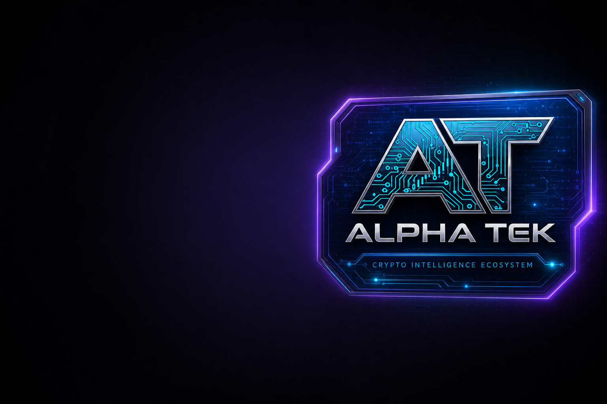

<!--
  PUBLIC ecosystem whitepaper synopsis (2026 refresh).
  Condenses platform + AAI + multi-product stack without private code or ops IP.
-->

<p align="center">
  <a href="https://www.alphatek.app">
    
  </a>
</p>

<div align="center">

  <h1>Alpha Tek · Epic Alpha</h1>
  <h3>Ecosystem Whitepaper Synopsis</h3>

  <p>
    <strong>Crypto intelligence at one view. Free tools that must survive. Utility that earns its place.</strong>
  </p>

  <p>
    <em>Public synopsis · Version 2026.08 · Living document</em>
  </p>

  <p>
    <a href="https://www.alphatek.app">
      
    </a>
    &nbsp;
    <a href="https://discord.gg/EpicAlpha">
      
    </a>
    &nbsp;
    <a href="https://www.alphatek.app/changelog">
      
    </a>
  </p>

  <p>
    
    
    
  </p>

</div>

---

## 1. Abstract

**Alpha Tek** is a production **crypto intelligence ecosystem**:

1. **Epic Alpha Discord** — free community + Discord Tek Stack (200+ channels, hundreds of commands)  
2. **AlphaTek.App** — live multi-surface web portal (Explorer, Discover, TG Arena, KOL, Guard, Academy, AAI Hub, …)  
3. **Alpha Trench** — browser trench client (pair-page shell; public inspectable package on release)  
4. **AAI (AlphaAi)** — Solana utility token design with **devnet-proven** programs and a revenue-linked buyback flywheel  

The founding intent is blunt: **give real intelligence away** to people who got wrecked, refuse to get wrecked again, or only have a little capital — then make the system **self-sustaining** so the free layer is not a martyr project.

This document is a **public synopsis**. Implementation monorepos remain private by default. Working product surfaces are public.

---

## 2. Problem

| Failure mode | Result |
|--------------|--------|
| Tab hell | Eight terminals, zero shared session memory |
| Free forever decay | Founders burn out; free tools die |
| Token-first vapor | Dec without product |
| Discord noise | Channel spam with no operator structure |
| Vendor cosplay | User interfaces advertising someone else’s brand |

---

## 3. Solution — One Ecosystem, Three Product Planes

```text
┌──────────────────────────────────────────────────────────────┐
│                     ALPHA TEK ECOSYSTEM                        │
├────────────────┬─────────────────────┬───────────────────────┤
│  EPIC ALPHA    │  ALPHATEK.APP       │  ALPHA TRENCH         │
│  Discord       │  Web portal         │  Browser extension    │
│  Free first    │  Full intelligence  │  Pair-page client     │
│  200+ Tek ch   │  Research + ops     │  Guard · Journal      │
└───────┬────────┴──────────┬──────────┴───────────┬───────────┘
        │                   │                      │
        └───────────────────┼──────────────────────┘
                            ▼
                 AAI UTILITY + SUBSCRIPTION
            access · stake · credits · buybacks
```

Product footprints (docs only, no private source):

| Plane | Public repo |
|-------|-------------|
| Portal | [alpha-tek-portal](https://github.com/JohnnyxSmokes/alpha-tek-portal) |
| Discord | [epic-alpha-discord](https://github.com/JohnnyxSmokes/epic-alpha-discord) |
| Extension | [alpha-trench](https://github.com/JohnnyxSmokes/alpha-trench) |
| Founder | [JohnnyxSmokes](https://github.com/JohnnyxSmokes/JohnnyxSmokes) |

---

## 4. Mission & Origin

**Mission:** multi-chain alpha that is accessible, fast, and usable — with a path from free community tools to paid depth without losing honesty.

**Origin:** Epic Alpha Discord was built to **give back**. Keeping everything free indefinitely with one-builder intensity was not sustainable. The pivot is not “become extractive.” The pivot is **subscriptions, licensing, and AAI utility** so free intelligence can endure.

**Founder:** JohnnyxSmokes (EpicAlpha · AlphaTek), Tampa FL, crypto since the **2012 BTC era**. Daily product shipping discipline (Cursor Day **81** era and ongoing). Shipping heat visible on GitHub contribution graphs — largely private repos by design.

---

## 5. Web Portal (Alpha Tek App)

Live: **[https://www.alphatek.app](https://www.alphatek.app)**

| Surface | User outcome |
|---------|--------------|
| Explorer | Multi-chain market / token context |
| Discover | Narrative and pool heat discovery |
| Launch / Pump rails | Solana new-pair lifecycle context |
| Wallet views | Portfolio + enrichment where connected |
| Quant | Social trading / calls / flex culture |
| TG Arena | Telegram-call operator views |
| KOL Scope | Social influencer heat, carefully framed |
| Alpha Guard | Host / domain / mint / approval awareness |
| Alpha Terminal | Research coin pages |
| Alpha Academy | Interactive education |
| AAI Hub | Utility rails (stake / claim / activity) |
| Build Journey | Public changelog of real shipping |

**Security principles (product-level):**

- API secrets never shipped to browsers  
- Authenticated sessions for personal / paid state  
- Alpha-branded safety language instead of scattered vendor widgets  

---

## 6. Discord Tek Stack (Epic Alpha)

Join: **[https://discord.gg/EpicAlpha](https://discord.gg/EpicAlpha)**

Discord is not a support ticket booth. It is a **production intelligence server**:

- **HQ** onboarding, multi-chain call and trade rooms, analysis lounges  
- **Pump.fun + Solana radars** for launch velocity  
- **KOL / Dev monitors** and rank boards  
- **Multichain trending radars**  
- **News / macro central** and curated **X / KOL trackers**  
- **Alpha Tools** (sentiment, whales, Polymarket suite, DEX tools)  
- **Call bots + monitor health** lanes for operational visibility  
- Daily **Morning Brief** and market report style products  

Scale narrative: **200+** specialized Tek channels, **hundreds** of commands, multi-year embed delivery with reliability culture. Bot source and bridge workers stay private; the community experiences the product live.

Licensing Discord Tek packs is a commercial pillar for other servers / operators.

---

## 7. Alpha Trench (Browser Client)

Chrome MV3 trench client: Instant Trade shell, honesty ladder (paper / practice first), Alpha Guard on social hosts, mint context, journal / replay path, optional portal link.

**Why a separate product footprint:** extensions must be **inspectable**. Core platform need **not** be open for that trust to exist.

Repo: [alpha-trench](https://github.com/JohnnyxSmokes/alpha-trench)  
Portal pairing: [alphatek.app](https://www.alphatek.app)

---

## 8. Data & Partner Footprint (Public Language)

Alpha user interfaces **do not costume as third-party brands**. Under the hood, production intelligence composes many rails, including families such as:

| Domain | Examples (integration classes) |
|--------|--------------------------------|
| On-chain / wallets | Moralis · Cielo · Helius-class Solana · Jupiter |
| DEX / launch discovery | Pump.fun · Raydium-class · research price anchors |
| Social / KOL / TG | KOL boards · curated X packs · Telegram call pathways |
| Markets | CoinGecko · CMC-class · Hyperliquid · prediction markets |
| Auth / payments | Wallet-first auth (e.g. Privy-class) · Stripe |
| Infra | Cloud production hosting · PostgreSQL · institutional themes |

Exact service graphs, rate-limit lattices, and agent topologies are **private competitive IP**. Users buy outcomes: **fresh, multi-surface alpha under one brand**.

---

## 9. AAI Utility & Tokenomics (Design Synopsis)

**AAI (AlphaAi)** is a Solana SPL **utility** token design:

| System | Design |
|--------|--------|
| **Access tiers** | Hold thresholds (e.g. 1k / 5k / 50k class) gate platform depth |
| **Staking** | Tiered APY design; multi-position staking model |
| **Referral ladder** | Bronze → Platinum style commissions on paid referrals |
| **Credits / energy** | Spend path for premium AI / agent actions |

**Revenue → buyback flywheel (policy):**

```text
Subscriptions + licensing revenue
        │
        ▼
   25% → buybacks
        │
        ├── 50% burn (deflation)
        ├── 30% staking pool
        └── 20% treasury / reinvestment
```

**Honest status (critical):**

| Item | Status |
|------|--------|
| Platform / Discord / portal | **Live** |
| On-chain programs | **Devnet proven** (mint, staking, buyback, referral designs) |
| Mainnet mint / public sale | **TBD** — external audit required first |
| Utility marketing | Utility token — **not** an investment solicitation |

Devnet proof exists for deliberate readers; mainnet remains gated. Detail beyond this synopsis belongs on-product and in long-form token docs when published for mainnet.

---

## 10. Economic Stack (Non-Token)

| Stream | Role |
|--------|------|
| **Subscriptions** | Portal depth ($ tier ladder on product) |
| **Discord licensing** | Bring Tek packs to other communities |
| **AAI utility** | Retention + spend + stake alignment |
| **Free layer** | Discord + meaningful free portal surfaces as flywheel entry |

Sustainability funds more free tools over time — the inversion of “free until collapse.”

---

## 11. Competitive Thesis — Replication Cost

Alpha Tek is hard to clone as a **weekend fork** because the value is:

1. **Years** of production shipping (not Figma decks)  
2. **Discord Tek Stack** channel architecture and ops culture  
3. **Multi-surface** product (portal + Discord + extension)  
4. **Alpha brand** integrity (one label, many feeds)  
5. **Build Journey** public accountability at alphatek.app/changelog  
6. **Private core** until release slices are intentional  

Investors and rivals can clone a logo. They cannot cheaply clone operational trenches.

---

## 12. Public Proof Surfaces

| Proof | URL |
|-------|-----|
| Live portal | https://www.alphatek.app |
| Build Journey / changelog | https://www.alphatek.app/changelog |
| Discord | https://discord.gg/EpicAlpha |
| Founder GitHub heat | https://github.com/JohnnyxSmokes |
| Profile story | https://github.com/JohnnyxSmokes/JohnnyxSmokes |
| Product footprints | portal · discord · trench repos linked above |

Contribution graphs include private repository activity when the founder enables that setting — **greens without free clones**.

---

## 13. Roadmap Themes (Non-binding)

1. **Ship Alpha Trench** as fully inspectable public package + store trust reports  
2. **Chain / surface parity** — depth expanding without UX fragmentation  
3. **Safety stack** — Alpha Guard expansion across portal, Discord, extension  
4. **AAI mainnet gates** — external audit, mint authority policy, deliberate launch  
5. **Licensing & distribution** — Discord packs + partner embeds under Alpha brand  
6. **Education** — Academy and founder-led literacy so free tools teach, not just dump data  

---

## 14. Risks & Disclaimers

- Crypto markets are high risk; intel tools **do not** remove loss likelihood  
- Automated feeds can be wrong, delayed, or gamed — verify  
- Token utility designs can change; devnet ≠ mainnet  
- This synopsis is **information**, not an offer of securities or investment advice  
- Always DYOR  

---

## 15. Contact

| | |
|--|--|
| Portal | https://www.alphatek.app |
| Discord | https://discord.gg/EpicAlpha |
| X | https://x.com/BitcoinHomework · https://x.com/AlphaTekBot |
| GitHub | https://github.com/JohnnyxSmokes |

---

<div align="center">

  <sub>
    Alpha Tek · Epic Alpha — Public Ecosystem Whitepaper Synopsis · 2026<br />
    Built with passion since BTC 2012 · Core private · Product public
  </sub>

</div>
